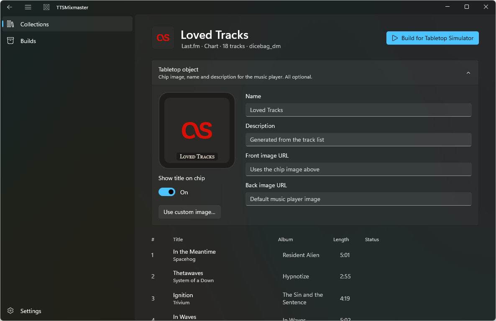

# TTSMixmaster

Turn your playlists into Tabletop Simulator music chips. TTSMixmaster takes a playlist or chart from
Last.fm, YouTube or Spotify, finds and downloads each track's audio, uploads the MP3s to your Azure Blob
Storage, and exports a ready-to-place music chip into Tabletop Simulator's Saved Objects. The chips are
designed for the [Music Box](https://steamcommunity.com/sharedfiles/filedetails/?id=3114355269).

TTSMixmaster is a native Windows app (WinUI 3, .NET 10) for Windows 10 1809+ and Windows 11, x64 and ARM64.



## Features

- **Your music services:** Last.fm charts (top, loved and recent tracks), YouTube playlists and Spotify
  playlists. Search, or paste a playlist link.
- **Audio:** yt-dlp and FFmpeg are bundled; tracks are found, downloaded and converted to MP3 at the
  quality you choose. yt-dlp updates itself without an app release.
- **Azure Blob Storage:** sign in with your Microsoft account and pick a container; the app checks access
  and public read and offers to fix them. Uploads are de-duplicated by content.
- **Chips:** collection art in the chip frame with the collection name, or your own image. Name,
  description and images are editable.
- **Export to TTS:** writes the chip straight into Saved Objects, replacing its earlier export in place.
  **Builds** keeps every finished chip for re-export.

## Install

Download from the [latest release](https://github.com/MWG-Logan/TTSMixmaster/releases/latest):

- **Recommended:** `TTSMixmaster.appinstaller`. Open it to install with App Installer. It picks the right
  build for your PC and keeps TTSMixmaster up to date automatically.
- `TTSMixmaster-v<version>.msixbundle`: the same signed MSIX package, for offline installs and IT
  deployment (Intune, Configuration Manager).
- `TTSMixmaster-v<version>-portable-x64.zip` / `-portable-arm64.zip`: unzip and run `TTSMixmaster.exe`,
  nothing to install.

Everything is included (the .NET runtime, Windows App SDK, yt-dlp and FFmpeg). See the
[Installation Guide](docs/INSTALLATION.md) for details and for getting the music-service API keys.

## Use

1. **Settings:** connect the music services you use and sign in to Azure Storage.
2. **Collections:** pick a playlist or chart.
3. **Build for Tabletop Simulator**, then **Export to TTS**.
4. In Tabletop Simulator: **Objects → Saved Objects → TTSMixmaster**, and click the chip to place it.

## Documentation

- [Installation Guide](docs/INSTALLATION.md): install options and music-service setup
- [Usage Guide](docs/USAGE.md): a walkthrough of the app
- [Azure Storage setup](docs/AZURE_SETUP.md)
- [TTSMixmaster in Tabletop Simulator](docs/TTS.md): what the chip contains and how it plays
- [Configuration](docs/CONFIGURATION.md): where settings, logs and files live
- [Troubleshooting](docs/TROUBLESHOOTING.md)

## Build from source

You need the .NET 10 SDK on Windows. The solution has no AnyCPU configuration, so pass a platform:

```powershell
dotnet build TTSMixmaster.slnx -p:Platform=x64
dotnet test --project tests/TTSMixmaster.Core.Tests
```

See [AGENTS.md](AGENTS.md) for the project layout and conventions, [docs/TESTING.md](docs/TESTING.md)
for the test layers and [docs/RELEASING.md](docs/RELEASING.md) for packaging. Contributions are welcome:
see the [Contributing Guide](.github/CONTRIBUTING.md).

## License

[MIT](LICENSE). Respect the terms of service of the music services you connect, and copyright and
licensing of the audio you download. Use custom chip images only if you have the right to.
